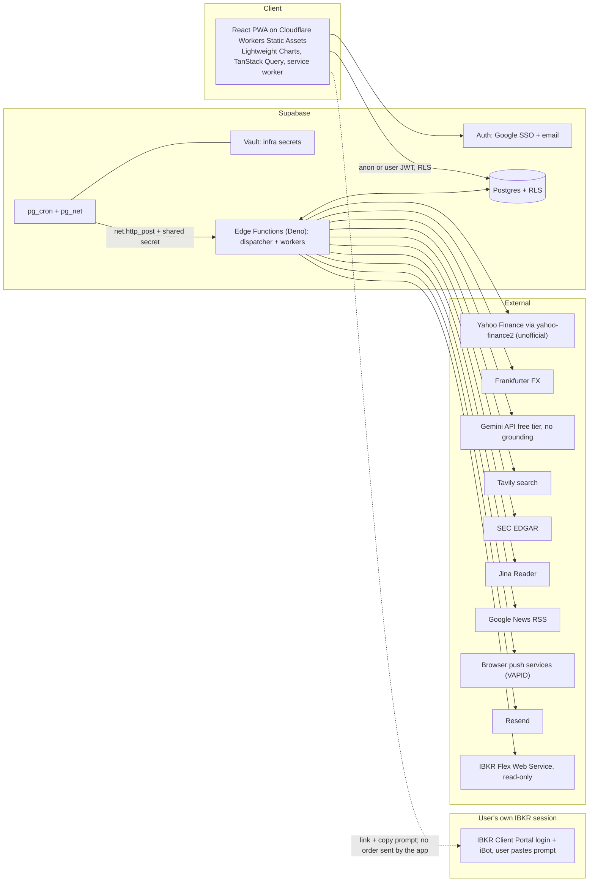

# Phase 1 - Discovery and feasibility deliverables

Project: personal stock screener (working name `personal-stock-sreener`, repository spelling kept).
Date of discovery: 2026-10-15. Every external claim in this document is carried from the research documents in `docs/discovery/research/` (cited by relative path and section) or from the owner decision record in section 0. Nothing here was re-verified against the live services by this document.

Full design (schema, functions, jobs, RLS policies) is in `docs/superpowers/specs/2026-10-15-stock-screener-design.md` (written in parallel; this document does not duplicate its schema).

Conventions used in this document:

- **Unverified** means the research document itself marked the claim unverified, or only found it in a search snippet, a summarising fetch or a third-party page. The label is preserved, never upgraded.
- "Brief" means `prompt.txt` at the repository root. "Research" paths are relative to `docs/discovery/research/`.
- Quoted text is as returned by the research documents. Page-reader quotes must be re-checked on the live page before any legal reliance (the research documents say so themselves).

## 0. Decision record (owner, 2026-10-15)

| # | Decision | Consequence | Detailed in |
|---|---|---|---|
| D1 | Use `yahoo-finance2` (unofficial Yahoo Finance access) for market data regardless of the Yahoo terms of service. It is the owner's accepted risk, not a verified permission. | Public pages may show Yahoo-derived data; mitigations in section 5. | 5 |
| D2 | FX from Frankfurter. | Free, keyless. Currency coverage partly unverified. | 4 (I2) |
| D3 | Research: Gemini API free tier (no Search grounding), Tavily free, SEC EDGAR, Jina Reader. | No paid AI tier. Free-tier quotas bound daily research volume. | 4 (I14-I17) |
| D4 | Notifications: Web Push (VAPID, `jsr:@negrel/webpush`) and Resend email. | Push library needs an empirical spike. | 4 (I10, I11) |
| D5 | IBKR: Flex Web Service, read-only. No order placement by the app. Instead a hand-off: IBKR login link plus an iBot prompt the user pastes. | Part XI (order lifecycle) of the brief is out of scope. | 6 |
| D6 | Hosting: Cloudflare-hosted React PWA. Backend: Supabase Postgres, Auth, Edge Functions, pg_cron, Vault. | See section 2. | 2 |

## 1. Repository audit

### 1.1 Inventory

Observed on 2026-10-15 in `C:\Data\git_repos\_tests\nira\personal-stock-sreener\`:

| Path | State |
|---|---|
| `README.md` | Tracked. Contains only the title line `# personal-stock-sreener`. |
| `prompt.txt` | Untracked. The production engineering brief (1,977 lines). |
| `stddevchn.pine` | Untracked. The authoritative Pine Script indicator (176 lines). |
| `docs/` | Untracked. Created during discovery: `docs/discovery/pine-script-analysis.md`, `docs/discovery/fixtures/stddevchn-synthetic.json`, `docs/discovery/research/*.md` (8 files), and this document. |

Git: branch `master`, tracking `origin/master`, one commit (`c67c8bd Initial commit`).

### 1.2 Audit against brief section 3.1

| Item to inspect (brief 3.1) | Finding |
|---|---|
| Project structure and package manifests | None. No `package.json`, lockfile, `tsconfig`, `deno.json`. |
| React/TypeScript framework and build setup | None. |
| Authentication and route protection | None. |
| Supabase schemas, migrations, RLS, Edge Functions, Cron jobs | None. No `supabase/` directory, no `config.toml`. No Supabase project exists yet. |
| Environment variables and secret management | None. No `.env*`, no `.gitignore`, no secret store. |
| Hosting and domain configuration | None. No Cloudflare configuration, no `wrangler.*`. Domain: not known (owner action, section 9). |
| Charts, notifications, data providers, test infrastructure | None. |
| Development/production separation | None. |
| CI/CD, deployment, monitoring, rollback | None. No `.github/`, no workflows. |

### 1.3 Development toolchain on the owner's machine

Windows 11 Enterprise. Bun 1.3.14, Node 22.13.1, Docker Desktop 28.1.1 (running), Supabase CLI 2.121.0 used through `bunx supabase`. Deno 2.9.6 was installed during the yahoo-finance2 spike via npm (`npm i -g deno`; `research/yahoo-finance2-spike.md` section 3.9). No `gh` CLI.

Implications recorded by the research:

- Vite 8, Vitest 5 and ESLint 10 need Node 20.19 or 22.12+, so keep Node installed and use Bun as the package manager; run Vitest under Node. The Bun-on-Windows notes are secondary sources and Unverified (`research/charting-hosting-stack.md` section 4).
- The same table lists `react-router` 8.4.0 with Node `>=22.22.0` and jsdom 30.1.2 with Node `^22.22.2 || ^24.15.0 || >=26`. The installed Node 22.13.1 is below both. This is our reading of two reported facts and was not tested; either upgrade Node or avoid those versions.
- `yahoo-finance2` 4.0.3 requires Node >= 22.0.0 (spike section 3.1), which is satisfied.
- Local Supabase needs `supabase start` before `functions serve` (spike section 3.9).
- Without `gh`, CI and PR interaction goes through git and the GitHub web UI unless `gh` is installed.

### 1.4 Conclusion

The repository is greenfield. Nothing exists to extend or preserve except the two input files: `prompt.txt` (requirements) and `stddevchn.pine` (the authoritative indicator). The brief's "do not start a fresh application if the current repository can reasonably be extended" (3.1) does not apply because there is no application. The build starts from scaffold (phase P0).

## 2. Architecture description

### 2.1 Diagram (Mermaid)



### 2.2 Plain-text equivalent

```
Browser (React PWA on Cloudflare) --public data / own rows via RLS--> Supabase Postgres
Browser --sign-in--> Supabase Auth (Google or email)
pg_cron (UTC) --pg_net.http_post + shared secret--> Edge Function dispatcher --> worker Edge Functions
Worker Edge Functions <--read/write--> Postgres (job table, checkpoints, results)
Worker Edge Functions --> Yahoo Finance (yahoo-finance2): universe, quotes, daily bars, news
                      --> Frankfurter: FX rates
                      --> SEC EDGAR, Google News RSS, Tavily, Jina Reader: evidence retrieval
                      --> Gemini API (free tier, no grounding): structured synthesis
                      --> Web Push services (VAPID) and Resend: notifications
                      --> IBKR Flex Web Service: read-only account statements
User --opens link, pastes copied prompt--> IBKR Client Portal / iBot (the user submits any order there)
The app never holds IBKR credentials and never places or modifies an order.
```

### 2.3 Components

**Cloudflare-hosted React PWA.** A single-page application served as static assets by Cloudflare Workers Static Assets on the free plan (static asset requests "free and unlimited"; SPA fallback through `not_found_handling = "single-page-application"`; `_headers` and `_redirects` supported). No non-commercial clause was found in the Cloudflare terms excerpt; the only restriction found is the ban on processing card data on free-service properties (`research/charting-hosting-stack.md` section 3). Researched stack: Vite 8.3.4, React 19.3.1, TanStack Query 5.104.2, Tailwind 4.3.3, vite-plugin-pwa 2.0.0 with `injectManifest`, Vitest 5.0.4, Playwright 1.64.1, Zod 4.6.7, supabase-js 2.117.3 (npm `latest` on 2026-10-15). TypeScript must be pinned to 6.x if typescript-eslint is used (its peer range is `<6.1.0` while npm `latest` is 7.0.2). The service worker precaches only the static build and never caches Supabase responses. The chart is TradingView Lightweight Charts 5.2.1 (Apache-2.0 plus an attribution obligation: the NOTICE text and a link to tradingview.com on a user-visible page and/or the default `attributionLogo`).

**Supabase Postgres, Auth, Edge Functions, pg_cron, Vault.** Postgres holds all state under RLS: public screening data is world-readable, everything private is owner-only. Auth provides Google SSO and email sign-in; JWTs are verified in functions with `getClaims()` or a JWKS-aware library. Edge Functions (Deno) run a thin dispatcher and the workers. The limits that shape the design are wall clock 150 s (Free) or 400 s (paid), CPU 2 s and memory 256 MB (`research/supabase-push-email.md` section 2), so each invocation is one small unit of work with durable checkpoints. The research recommends a plain `scan_jobs` table with leases and `for update skip locked` over pgmq (same document, section 4). pg_cron runs in UTC; two entries (07:00 and 08:00 UTC) plus a Sofia-hour guard give a DST-safe 10:00 Europe/Sofia start (section 3). Vault stores infrastructure secrets (project URL, cron shared secret). The per-user Flex token is encrypted at application level with a key held in function secrets (section 5).

**Yahoo Finance via yahoo-finance2.** `yahoo-finance2` 4.0.3 (MIT, "use at your own risk") ran unchanged in `supabase/edge-runtime:v1.77.4` (Deno 2.1.4 compatible) for `quote`, `chart` and `search` (`research/yahoo-finance2-spike.md` section 1). The library cannot run custom screeners, so universe discovery uses the raw Yahoo screener endpoint with cookie and crumb (hand-rolled `fetch`, demonstrated in Bun, not yet inside the Edge Runtime). It sits behind a TypeScript provider interface so financial calculations never import it directly. Licensing decision in section 5.

**Frankfurter FX.** Daily mid-market rates, no API key, "no quotas" (an abuse rate limit exists), 223 currencies from 104 central banks and official sources (`research/market-data-providers.md` section 2.14). It converts per-exchange market-cap thresholds (the Yahoo screener applies the threshold in local currency) and computes USD market caps. Coverage of SAR, TWD and similar currencies is Unverified. Open Exchange Rates is the researched fallback, and the spike resolved 38 currencies through Yahoo FX quotes such as `EURUSD=X` (spike section 3.7).

**Research pipeline: Gemini free tier, Tavily, EDGAR, Jina Reader.** Our own code collects evidence (EDGAR submissions and filings, Google News RSS, Yahoo news for US-style tickers, Tavily search, Jina Reader for PDF and HTML to text) into an evidence ledger. The Gemini free tier (a Flash-Lite model, JSON output, no Google Search grounding, no URL context) only synthesises text over that ledger, so every citation is a URL we fetched ourselves and the grounded-results terms never apply (`research/free-ai-and-search-tiers.md` sections 1, 4, 6). A report is accepted only if every cited URL is in the ledger. The paid Claude pipeline researched in `research/ai-research-providers.md` is not selected (see sections 4 and 10).

**Web Push and Resend.** Web Push uses VAPID keys generated by us and `jsr:@negrel/webpush` v0.5.0 (Web Crypto based; its README warns it "hasn't been reviewed by crypto experts"); a spike in the Edge Runtime is mandatory (`research/supabase-push-email.md` sections 7 and 11.5). iOS and iPadOS need 16.4+, the app on the Home Screen, `display: standalone` in the manifest and a permission request from a user gesture. Resend is called by `fetch` to `https://api.resend.com/emails` with an `Idempotency-Key` such as `digest:<user_id>:<local_date>`, one-click `List-Unsubscribe` headers and Svix-signed webhooks. The two channels are independently configurable per user.

**IBKR Flex Web Service, read-only.** The user creates an Activity Flex Query and a token in Client Portal; a cron-triggered function calls `SendRequest` then `GetStatement` and loads Postgres. It supplies cost basis, FIFO realized P&L, dividends, commissions, FX per date, transfers and NAV, end-of-day only (section 6). No IBKR credential other than the token is held.

**IBKR hand-off instead of order placement.** For a chosen instrument the app shows a "Trade this" card (company, IBKR local symbol, exchange code IBIS then AEB, conid, ISIN, currency), a link to the IBKR Client Portal login and a copy button for an iBot prompt such as `Buy 10 shares of MSF at 400 limit`. The user logs in and submits any order themselves; iBot "prepares the order ticket for review before submission" and nothing is sent until the user presses Submit (`research/ibkr-flex-links-ibot.md` section 5.1). IBKR documents no deep link to an instrument (same document, section 3).

### 2.4 Decisions and rejected alternatives

| Area | Chosen | Alternatives researched and why not | Source |
|---|---|---|---|
| Hosting | Cloudflare Workers Static Assets (free) | Cloudflare Pages is acceptable (docs say "Start new projects with Workers"); Vercel Hobby is contractually non-commercial-only; GitHub Pages terms prohibit running an online business or SaaS; Netlify, Render, Firebase Spark are fallbacks (Firebase 360 MB/day transfer is tight) | `research/charting-hosting-stack.md` section 3 |
| Chart library | Lightweight Charts 5.2.1 | KLineChart 10.1.0 (runner-up, no attribution found); Apache ECharts 6.1.0 (large, weaker price-scale interaction); Highcharts and amCharts need paid licences for public sites; Chart.js financial plugin is stale | same, section 2 |
| Job coordination | Plain `scan_jobs` table with leases and `for update skip locked` | Supabase Queues (pgmq) offers SQS-style semantics; `pgmq_public` RPC from Edge Functions not verified | `research/supabase-push-email.md` section 4 |
| Cron schedule | Two UTC entries plus a Sofia-hour guard | A single `cron.timezone` setting: no evidence it can be set on hosted Supabase | same, sections 3, 11.1 |
| Broker token storage | Application-level AES-256-GCM, key in function secrets | Vault decrypted view (plaintext to any role granted it) | same, section 5 |
| Push library | `jsr:@negrel/webpush` | `npm:web-push` (one concrete Deno failure fixed upstream in Oct 2024, no documented successful Supabase deployment); `web-push-neo`, `@pushforge/builder` as fallbacks | same, sections 7, 11.5 |
| AI research | Gemini free tier over our own evidence | Paid Claude with server-side web search and Batch API (about $0.21-$0.31 per mid report, search fee $10 per 1,000); OpenAI, Perplexity; Gemini grounding excluded by its terms | `research/ai-research-providers.md` sections 1-3, 5.2; `research/free-ai-and-search-tiers.md` section 4 |
| Market data | `yahoo-finance2` (owner decision) | EODHD, FMP, Twelve Data and others: display rights not available at hobby prices | section 5 |
| IBKR | Flex read-only plus hand-off | CPGW bridge, OAuth 1.0a, OAuth 2.0 | section 6 |

## 3. Database and data-flow summary

Schema, indexes, constraints and RLS policies are specified in `docs/superpowers/specs/2026-10-15-stock-screener-design.md`. This section only fixes the vocabulary.

### 3.1 Entity groups (brief 13.2, adjusted by the decisions)

| Group | Contents (summary) | Access |
|---|---|---|
| Identity and reference | companies, securities (never keyed by ticker), exchanges, currencies, ticker aliases, EUR-equivalent mappings, field provenance | public read |
| Market data | daily bars (split-adjusted OHLC, completed bars only), splits, dividends, FX rates, market-cap snapshots | public read |
| Universe | universe snapshots and ranks per mode (Worldwide, US only), membership-change events (7-day detail) | public read |
| Screening | daily scan executions, job table with leases and checkpoints, Today's Discounts, signal states and episodes | public read for results; service-only for jobs |
| Research | fundamental reports, evidence ledger rows, source references, URL verification results | public read for published reports |
| Users | profiles, notification preferences, Web Push subscriptions | owner only |
| Notifications | notification events, delivery attempts, deduplication keys | owner only |
| Broker (read-only) | Flex connection metadata, encrypted token with `key_version`, import state, positions, trades and closed lots, cash transactions, FX per date, NAV, hand-off records | owner only |
| Operations | pipeline runs (`run_date` unique), audit and security events, health status, cleanup state | service or admin |

Removed by decision D5: orders, order updates, fills and reconciliation states for app-placed orders. Executions reported by Flex are stored as trade history instead.

Identity note from the research: Yahoo provides no ISIN anywhere (`research/yahoo-finance2-spike.md` sections 3.3 and 3.4), so the company and security keys must be built from other fields. The market-data research proposes company key = LEI (fallback CIK, then manual) and security key = FIGI, with a `field_provenance` table (`research/market-data-providers.md` section 4). Both depend on free identity sources (OpenFIGI, GLEIF, EDGAR) whose terms were only partly read; the spec decides the final keys.

### 3.2 Daily data flow (high level)

1. **Trigger.** pg_cron fires at 07:00 and 08:00 UTC. A SQL function proceeds only when the Sofia local hour is 10, inserts one `pipeline_runs` row per local date (idempotent), then fires the dispatcher through `pg_net`.
2. **Universe refresh.** The spike recommends a weekly job: a per-exchange Yahoo screener sweep with FX-derived local thresholds, a post-filter to US$50B, de-duplication of secondary listings, snapshots and ranks per mode.
3. **Bars.** `chart()` per security in slices of at most 15-20 per invocation; null rows dropped; completed-versus-forming rule applied; last ~5 bars refetched each run; full history refetched on a new split event.
4. **Indicator.** A pure TypeScript port of `stddevchn.pine` (length 2500, source close; see `docs/discovery/pine-script-analysis.md`), then thresholds, the rank-dependent -3/-4 conditions, the zero-line filter and signal episodes.
5. **Research.** For discounted companies and selected holdings: deterministic EDGAR prefetch, evidence gathering, Gemini synthesis, URL verification, classification.
6. **Digest and notifications.** The digest is composed after research completes; Web Push and Resend are dispatched with idempotency keys and delivery tracking.
7. **Portfolio.** The Flex statement is pulled once per day (next morning), parsed and stored; positions are combined with Yahoo prices for display.
8. **Cleanup.** Expire 7-day summary data and job logs; keep audit history and signal deduplication data. A reaper job re-enqueues stale job leases every few minutes.

Each Edge invocation performs one unit of work and persists a checkpoint, because `pg_net` is fire-and-forget (default timeout 2000 ms, responses kept 6 hours) and the Edge limits are 150 or 400 s wall clock and 2 s CPU (`research/supabase-push-email.md` sections 1 and 3).

### 3.3 Yahoo fields feeding the data model (from the spike)

| Need | Yahoo source | Caveat |
|---|---|---|
| Native currency | `quote().currency` | Minor units `GBp`, `ZAc`, `ILA` (and `KWF` possible) must be divided before FX; `marketCap` for SHEL.L was verified in GBP while `currency` is `GBp` (verified only for GBp) |
| Market cap and shares | `quote().marketCap`, `sharesOutstanding` | No separate market-cap timestamp; the timestamp is `regularMarketTime`; secondary listings carry the primary's market cap |
| Exchange and name | `exchange`, `fullExchangeName`, `longName`, `exchangeTimezoneName` | `displayName` only for some names |
| First trade date | `firstTradeDateMilliseconds` | Used for the 10-year listing rule together with our own first bar date |
| Daily OHLC | `chart()` `open/high/low/close` split-adjusted; `adjclose` split plus dividend adjusted | Bar timestamps are the session-open instant in UTC; derive the trading date in the exchange timezone; null rows exist |
| Splits, dividends | `chart().events` | Dividend amounts are split-adjusted too |
| Sector, industry, country | `quoteSummary` `assetProfile` or `search()` | Not available from `quote()` or the screener |
| ISIN, ADR flag | none | ADR inferred from non-US `assetProfile.country` plus a US exchange |
| News | `search(symbol, {newsCount})` | Only for US-style tickers; max 50 per call; history is days, persist daily |
| Session state | `marketState`, `meta.currentTradingPeriod.regular` | Basis of the completed-versus-forming rule |

### 3.4 Time and bar rules

- A bar is **completed** if `bar.date < currentTradingPeriod.regular.start` or `meta.regularMarketTime >= currentTradingPeriod.regular.end`; otherwise it is forming and must not be persisted as final. Cross-check with `quote().marketState`. The rule was derived from observations; lunch breaks (HKG, JPX, SHH) and half-days are not verified, and whether the volume of a completed bar is final immediately after the close is not verified (spike 3.2).
- The indicator input is "the latest 2,500 valid completed daily bars": drop bars with null close (and null high/low), take the newest L in chronological order, exclude the in-progress candle; fewer than L bars means "insufficient data" and no channel (`docs/discovery/pine-script-analysis.md` section 7).
- TradingView's `barstate.islast` is also true on every realtime tick, so Pine values intraday include the unconfirmed candle; parity checks against TradingView should be done after the close (analysis H8).
- Scheduling is in UTC (07:00 and 08:00) with a Sofia-local-hour guard; Sofia is UTC+2 in winter and UTC+3 in summer.

## 4. External integration feasibility matrix

Brief 3.2 asks for ten attributes per integration. The matrix is split into three tables with the same row identifiers (I1-I18): 4.1 covers use case, permission, authentication, cost and Edge feasibility; 4.2 covers limits, owner setup, freshness/redistribution and failure behaviour; 4.3 gives the verification status and the document to open. "Edge" means a Supabase Edge Function.

### 4.1 Support, permission, access, cost, Edge feasibility

| ID | Integration | Use case supported? | Production / public use allowed? | Auth / account needed | Cost | Feasible in Edge? |
|---|---|---|---|---|---|---|
| I1 | Yahoo via `yahoo-finance2` 4.0.3 | Yes for quotes, 11-year daily bars, search, quoteSummary; universe only via raw screener endpoint; news only for US-style tickers; no ISIN | **No verified permission.** Yahoo ToS bans automated collection and commercial reuse (section 5). Owner accepted the risk (D1) | None; cookie plus crumb obtained per cold start | Free | Yes: quote, chart, search ran in edge-runtime 1.77.4; raw screener not yet tried in Edge |
| I2 | Frankfurter FX | Yes (daily mid-market rates) | Not stated in the notes read; terms not reviewed. Unverified | None, no key | Free | Plain HTTPS GET; not run in Edge (inference) |
| I3 | IBKR public "webrest" lookup (`/webrest/...` behind the Products, Exchanges and Contracts page) | Yes for conid, ISIN, local symbol by exchange (IBIS, AEB) without login | **Unverified.** Undocumented endpoints; website terms not found; `robots.txt` does not disallow `/webrest/` | None | Free | Plain HTTPS; tested with `curl`, not from Edge |
| I4 | IBKR Flex Web Service | Yes for history, cost basis, realized P&L, dividends, commissions, FX, NAV; no live prices, no orders | Nothing in IBKR docs forbids server calls; token and Query ID are the only credentials | Funded IBKR account; user-created Activity Flex Query and token | Free | Yes in principle: two HTTPS GETs plus XML/text parsing (not tested in Edge) |
| I5 | IBKR Web API / OAuth (**rejected**) | Would cover live quotes and orders, but no supported headless path for an individual account | OAuth 2.0: "not available to Individual account structures". OAuth 1.0a for individuals: Unverified (docs say institutional; community reports it works) | CPGW needs a daily 2FA browser login on the same machine | Free | **No** for CPGW (local Java process); OAuth 1.0a feasible in principle but unsupported |
| I6 | Supabase Edge Functions | Yes for thin workers | Yes (platform use) | Supabase project | Free or Pro (from $25/month) | Is the platform. Limits in 4.2 |
| I7 | pg_cron + pg_net | Yes for scheduling and fire-and-forget HTTP | Yes (platform use) | Supabase project | Included | Runs in the database, not in Edge |
| I8 | Supabase Auth + Google | Yes (Google OAuth, email, identity linking) | Yes | Google Cloud OAuth client of type "Web application" | Free: 50,000 MAU | Auth runs in Supabase; JWT verification in Edge through `getClaims()` |
| I9 | Supabase Vault | Yes for infrastructure secrets | Yes | Supabase project | Included | Read from SQL; cron passes values to Edge |
| I10 | Web Push via `jsr:@negrel/webpush` v0.5.0 | Yes in principle: RFC 8291/8292 on Web Crypto, Deno listed | Library licence not recorded in the research; standard push protocol | VAPID key pair generated by us; user permission per device | Free | **Unconfirmed**: spike required in Edge Runtime |
| I11 | Resend | Yes (transactional email, digests, SMTP for Supabase Auth) | Yes within plan limits | Resend account; verified sending domain | Free: 3,000/month, 100/day; Pro $20/month | Yes: plain `fetch` (Supabase's own example) |
| I12 | Cloudflare Workers Static Assets | Yes (SPA hosting, PWA files) | No non-commercial clause found in the terms excerpt read | Cloudflare account; wrangler API token | Free tier | Not applicable (hosting) |
| I13 | Lightweight Charts 5.2.1 | Yes for candles, line, area, zoom, pan, touch, themes | Yes, Apache-2.0 with attribution obligation | None | Free | Not applicable (browser) |
| I14 | Gemini API free tier | Yes for text synthesis and JSON output over our own evidence; **not** for grounding | Gray: free-tier content is used to improve Google products; terms say use is for "professional or business purposes, not for consumer use" (open question for a private individual) | Google AI Studio API key | Free | Plain REST or OpenAI-compatible endpoint (beta); not run in Edge |
| I15 | Tavily free | Yes for web search (1 credit basic, 2 advanced) | Terms not reviewed. Unverified | API key, no card | 1,000 credits/month free | Plain REST (not tested) |
| I16 | Jina Reader (`r.jina.ai`) | Yes for PDF/HTML to text | Storage terms not reviewed. Unverified | Keyless or API key (optional) | Free: 20 RPM keyless, 500 RPM keyed; 10M tokens per new key | Plain HTTPS (not tested) |
| I17 | SEC EDGAR | Yes for US filings, XBRL facts, filing lists; US SEC filers only | Public data; fair-access policy applies | None; declared `User-Agent` required | Free | Yes (plain HTTPS with the header) |
| I18 | Google News RSS | Partial: headlines and links for any company | Third-party summary: "designed for non-commercial use", attribution required. Official terms not fetched. Unverified | None | Free | Plain HTTPS (not tested) |

### 4.2 Limits, setup, freshness and redistribution, failure behaviour

| ID | Rate / runtime limits | Owner setup needed | Freshness / redistribution restrictions | Failure and recovery behaviour |
|---|---|---|---|---|
| I1 | No 429 seen in the spike at up to ~4-5 req/s (a few hundred requests over ~75 minutes); the real limit is **not established**. `quote` accepts 2500 symbols per call; 4000 gives HTTP 414. Screener `size` max 250. Library queue concurrency 4, no throttle, no retry | None | Last bar may be forming; completed rule in spike 3.2. Null OHLCV rows exist. ToS bans database/feed/widget creation that competes with Yahoo (section 5) | 429 surfaces as `HTTPError` with `code`; crumb re-acquired on HTTP 401 "Invalid Crumb". Plan: throttle to 3-4 req/s, backoff with jitter, circuit breaker, provider interface to swap |
| I2 | "No quotas" (abuse rate limit); coverage 223 currencies | None | Rates are daily mid-market, not intraday. Redistribution terms not reviewed | Fallback sources in notes: Open Exchange Rates (free 1,000 req/month, USD base) or Yahoo FX quotes; label missing FX honestly |
| I3 | None published; `pageSize` 2000 returned HTTP 500, use 100 and paginate | None | Descriptions can be stale (use ISIN); endpoints may change without notice | Manual entry of the local symbol as fallback; use only for an occasional (weekly) catalogue import |
| I4 | 1 request/s and 10 requests/minute per token; `User-Agent` header required; period max 365 days | Create Activity Flex Query, note Query ID, enable Flex Web Service, create token (6 hours to 1 year), IP restriction left off (Edge egress IPs not fixed) | End-of-day only: Activity Flex is updated once daily at close of business. Not for active polling. Time the statement becomes available is not published (Unverified) | Retryable errors 1001, 1004-1009, 1018, 1019, 1021 (classification is the research author's, not IBKR's); fatal 1010-1017, 1020. Wait ~5 s after `SendRequest`, retry `GetStatement` every 10-20 s, at most ~6 tries (recommendation, not IBKR's) |
| I5 | Global 10 req/s per username; brokerage session ends after 5 minutes idle; daily re-authentication; one brokerage session per username | n/a (rejected) | n/a | n/a. Recovery after the daily reset needs a human browser login for CPGW |
| I6 | Wall clock 150 s Free / 400 s paid; request idle 150 s; CPU 2 s; memory 256 MB; bundle 20 MB local (5 MB server-side); 100 functions Free. Hosted 2 s CPU not enforced by `functions serve`, so **not verified locally**; whether I/O wait counts is not stated | Create Supabase project; install CLI (`bunx supabase`) | n/a | One invocation = one unit of work with checkpoints; error 546 (`WORKER_RESOURCE_LIMIT`) is the CPU signal; reaper re-enqueues stale leases |
| I7 | pg_cron guidance: at most 8 concurrent jobs, each under 10 minutes (hard limit 32); `pg_net` default timeout 2000 ms, ~200 req/s, responses kept 6 hours; schedule is UTC | Enable extensions; create schedules | n/a | Fire-and-forget: inspect `net._http_response` and `cron.job_run_details`; purge old run details; idempotent `pipeline_runs` row per local date |
| I8 | Built-in email 2 messages/hour (custom SMTP mandatory, default 30/hour); per-IP auth endpoints 30 requests per 5 minutes | Google Cloud project: OAuth client (Web application), origins, redirect = Supabase callback URL; Client ID/Secret into Supabase; redirect allow-list; custom SMTP | Google sensitive scopes may need verification; only `openid`, email and profile planned | Identity linking by same email is automatic; unlinking needs at least 2 identities |
| I9 | n/a | None beyond project | Decrypted view exposes plaintext to any role granted it | Rotation procedure not researched; per-user broker token is **not** in Vault (application-level AES-256-GCM instead) |
| I10 | TTL mandatory; payload minimum supported 4096 bytes (the 4078 figure is Unverified); 429 honours `Retry-After` | Generate VAPID keys (script from the library) | iOS: Home Screen app required, user gesture for permission, show a notification per push (iOS requirement not verified this session) | 404 and 410 mean delete the subscription; Android Chrome, desktop browsers, `pushsubscriptionchange` not verified |
| I11 | 10 requests/second per team; free 100 emails/day and 3,000/month; batch up to 100 emails, 50 recipients each | Account, verify domain (SPF, DKIM, Return-Path; subdomain advised), API key | Bulk senders over 5,000/day to Gmail/Yahoo must support one-click unsubscribe; stop sending within 48 hours of an unsubscribe | `Idempotency-Key` (24 h, 256 chars); webhooks `email.bounced`, `email.complained`, `email.failed`, `email.suppressed`; verify Svix signature on the raw body |
| I12 | 20,000 files per version, 25 MiB per file; static asset requests unlimited; Worker invocations 100,000/day (not applicable to static assets) | Cloudflare account, wrangler token, custom domain | `_headers` 100 rules; set `Cache-Control: no-cache` for `/sw.js` and the manifest | Roll back by redeploying a previous build (operator guide, P7) |
| I13 | Not measured: gzip size | None | Attribution: NOTICE text and tradingview.com link on a user-visible page and/or `attributionLogo` default true | Right-extension of the channel lines needs a spike (extra line series with future time, or a series primitive) |
| I14 | Google publishes no free-tier table; **forum-sourced and Unverified**: 20 RPD for Gemini 3.8 Flash, 500 RPD for Flash-Lite. TPM unpublished | AI Studio API key; never enable billing | Grounded results may not be cached or syndicated and storage is capped at 2 years, so grounding is excluded. Do not send sensitive or personal data to unpaid services | Per-provider counters in the DB; on 429 or at 90% of quota switch provider, then queue with `not_before`; max 5 reports/day (proposal in the research) |
| I15 | Credits: 1,000/month; QPS not specified | Create key | Caching and display terms not reviewed | Rotate across search providers (Exa, Serper, Jina `s.jina.ai` with a key); on exhaustion run reports on EDGAR, IR, Yahoo and Google News only and flag "limited sources" |
| I16 | Keyless 20 RPM; keyed 500 RPM | Optional key | Storage terms not reviewed | Fallback to direct page fetch (15 s timeout) |
| I17 | Max 10 requests/second project-wide (use a DB-backed token bucket because Edge is stateless); whether SEC throttles shared Supabase egress IPs is unknown | None; choose a `User-Agent` with a contact | Public data. Full-text search endpoint is not a documented API (unsupported, use sparingly) | Back off; SEC fair-access policy applies |
| I18 | No cap documented | None | Attribution to Google News and each provider; link to the cluster (third-party summary) | Treat as best-effort source; never the sole evidence for a conclusion |

### 4.3 Verification status

| ID | Status | Where to look |
|---|---|---|
| I1 | Hands-on spike 2026-10-15 (library, Edge Runtime, limits). ToS text read through a page reader (re-check before legal reliance). Permission: **not verified, accepted risk** | `research/yahoo-finance2-spike.md`; `research/market-data-providers.md` 2.1; https://legal.yahoo.com/us/en/frontier/terms/otos/index.html |
| I2 | Docs read; SAR/TWD coverage and terms Unverified | `research/market-data-providers.md` 2.14; https://frankfurter.dev/docs/ |
| I3 | Endpoints tested with `curl`; permission **Unverified** | `research/ibkr-flex-links-ibot.md` section 4; https://www.interactivebrokers.com/robots.txt |
| I4 | IBKR primary docs read; paper-account support, statement-ready time, XML size, attribute spellings, Cash Transaction Type values **Unverified** | `research/ibkr-flex-links-ibot.md` section 2; https://www.interactivebrokers.com/docs/web-api/flex-web-service/introduction.md |
| I5 | IBKR primary docs read; individual OAuth 1.0a claim Unverified | `research/ibkr-feasibility.md` sections 1-2; https://www.interactivebrokers.com/docs/web-api/authentication/oauth-2/register.md |
| I6 | Docs read through a summarising fetch (re-verify 150/400 s and 2 s on the live page); hosted CPU behaviour not tested | `research/supabase-push-email.md` sections 2, 11.4; https://supabase.com/docs/guides/functions/limits |
| I7 | Docs read; `cron.timezone` on hosted Supabase Unverified (treat as UTC); pg_cron version on the project Unverified | `research/supabase-push-email.md` sections 3, 11.1; https://supabase.com/docs/guides/cron |
| I8 | Docs read; Google console steps from docs, not executed | `research/supabase-push-email.md` sections 6, 11.6; https://supabase.com/docs/guides/auth/social-login/auth-google |
| I9 | Docs read; pgsodium deprecation status Unverified | `research/supabase-push-email.md` section 5; https://supabase.com/docs/guides/database/vault |
| I10 | Library README and JSR page read; **no run in Edge Runtime yet**; conflicting evidence for `npm:web-push` | `research/supabase-push-email.md` sections 7, 11.5; https://jsr.io/@negrel/webpush |
| I11 | Docs read; Resend SMTP settings (host `smtp.resend.com`, port 465, user `resend`) from docs, not executed | `research/supabase-push-email.md` sections 8, 11.8; https://resend.com/docs/api-reference/rate-limit |
| I12 | Docs read through summaries; Workers Builds free minutes and full agreement Unverified | `research/charting-hosting-stack.md` section 3; https://developers.cloudflare.com/workers/static-assets/billing-and-limitations/ |
| I13 | Licence files read; right-extension and gzip size **not tested** | `research/charting-hosting-stack.md` section 2; https://raw.githubusercontent.com/tradingview/lightweight-charts/master/NOTICE |
| I14 | Pricing and terms read through a summarising fetch; free-tier numbers Unverified | `research/free-ai-and-search-tiers.md` sections 2, 4; https://ai.google.dev/gemini-api/terms |
| I15 | Pricing page read; ToS Unverified | `research/free-ai-and-search-tiers.md` section 3; https://docs.tavily.com/documentation/api-credits |
| I16 | Product page read; storage terms Unverified | `research/free-ai-and-search-tiers.md` section 3; https://jina.ai/reader/ |
| I17 | SEC page read | `research/ai-research-providers.md` section 5.1; https://www.sec.gov/search-filings/edgar-search-assistance/accessing-edgar-data |
| I18 | Third-party summary only; official terms Unverified | `research/free-ai-and-search-tiers.md` section 3; https://www.codewords.ai/blog/google-news-rss |

Cross-cutting runtime fact from the spike: a 500-symbol `quote()` plus 12 eleven-year `chart()` calls took 7.5 s wall in the local Edge Runtime; CPU was not measurable there. A Node CPU proxy suggests ~40-60 ms CPU per chart call, i.e. roughly 25-40 charts per invocation under 2 s minus cold-start load, so the plan is at most 15-20 charts per invocation (spike sections 3.8 and 3.9). This is the first thing to confirm on a hosted project (section 9).

### 4.4 Expected load against the limits

Figures are the research documents' estimates for roughly 600 securities (the brief's 400-600 target) and are not measured on a hosted project.

| Resource | Estimated daily demand | Limit | Reading |
|---|---|---|---|
| Yahoo `chart()` calls | ~600 on a full refetch; incremental runs refetch the last ~5 bars | no limit established; throttle 3-4 req/s | 600 calls at 3-4/s is about 2.5-3.5 minutes of pure request time; split across invocations of at most 15-20 charts, i.e. 30-40 invocations |
| Yahoo `quote()` | chunks of 500-1,000 symbols | 4,000 symbols gives HTTP 414 | a handful of calls per run |
| Edge invocations | well below 500,000 (Free) or 2 million (Pro) per month | see 4.2 row I6 | not a constraint |
| EDGAR | tens to hundreds of calls | 10 requests/second | not a constraint with a token bucket |
| Gemini free tier | worst case ~55 calls/day (5 reports chunked into about 3 calls each plus 40 checks) | forum-sourced 500 RPD (Flash-Lite), 20 RPD (3.8 Flash); both Unverified | fits 500 RPD only if the Flash-Lite figure holds; hence the 5-reports-per-day cap |
| Web searches | worst case ~110/day, ~3,300/month; typical ~50/day, ~1,500/month | Tavily 1,000 credits/month | the binding constraint; mitigated by RSS/EDGAR/Yahoo/Google News first, search only on a hit, provider rotation, target at most 1,000 per provider per month |
| Resend | digests per user per day | 100/day, 3,000/month, 10 req/s | a handful of users fit; more than 100 emails/day needs Pro ($20/month) |
| Flex | one statement per day | 10 requests/minute per token | not a constraint |
| Supabase egress and database | small | Free: 500 MB database, 5 GB egress | not a constraint for daily bars of ~600 securities (storage estimate not made) |

## 5. Market-data and licensing decision

### 5.1 Verdict from the research

Central finding of `research/market-data-providers.md` section 1: legal display rights, not data coverage, decide the choice. Every provider whose terms could be read restricts personal or individual plans to private or internal use and prohibits public display.

For Yahoo Finance the research verdict is "Do not use in production ... Decision: NO-GO for both cases (a) and (b)" (market-data section 1). Basis:

- **No official API.** A secondary source states Yahoo shut the old API on 15 May 2017 and never replaced it, and that yfinance uses the same unofficial endpoints as the Yahoo site ([Scrapfly guide](https://scrapfly.io/blog/guide-to-yahoo-finance-api/), secondary). No licensed Yahoo feed for small customers was found (absence of evidence, Unverified).
- **Yahoo Terms of Service** (effective 6 May 2025; [legal.yahoo.com](https://legal.yahoo.com/us/en/frontier/terms/otos/index.html)), clauses as returned by the page reader (`research/market-data-providers.md` section 2.1; re-check the page before legal reliance):
  - "access or collect data, or attempt to access or collect data, from our Services using any automated means, devices, programs, algorithms or methodologies, including but not limited to robots, spiders, scrapers, data mining tools, or data gathering or extraction tools, for any purpose without our express, prior permission."
  - "use any material or content from, including without limitation any data, (a) to create any database, archive, mobile application, data feed, widget or any other aggregated data source that competes with or constitutes a material substitute for the Services"
  - "Unless otherwise expressly stated, you may not access or reuse the Services, or any portion thereof, for any commercial purpose."
  - APIs: "we grant you a personal, royalty-free, non-transferable, non-assignable, revocable, and non-exclusive license to use the software and APIs we may provide to you as part of the Services" (personal use).
- **yfinance README** ([GitHub](https://github.com/ranaroussi/yfinance), quoted in `research/market-data-providers.md` section 2.1): "yfinance is **not** affiliated, endorsed, or vetted by Yahoo, Inc. It's an open-source tool that uses Yahoo's publicly available APIs, and is intended for research and educational purposes." and "Remember - the Yahoo! finance API is intended for personal use only."
- **yahoo-finance2 README, section "Unofficial API"** (verbatim from `research/yahoo-finance2-spike.md` section 6):

  > This project is neither created nor endorsed by Yahoo Inc. Yahoo does not provide any official API to developers, nor makes any guarantees regarding service availability or API consistency. In practice however, the open source community has kept this project (and it's predecessor) working well since 2013.
  >
  > Nevertheless, we make no guarantees and you use this package at your own risk. The developers (and obviously Yahoo) cannot be held responsible for any losses you may incur as a result of using this service. Use of this package is considered acknowledgement and acceptance of these terms and of its license.

  The spike also records that Yahoo's own terms for the data were not reviewed in the spike itself ("data redistribution rights are a separate question"); the terms were read in the market-data research.
- **Breakage history.** The crumb/cookie mechanism returns HTTP 429; users hit 429 after about 950 tickers (Nov 2024) and Portfolio Performance saw all quotes fail (Apr 2025) ([yfinance issue 2297](https://github.com/ranaroussi/yfinance/issues/2297), [Portfolio Performance forum](https://forum.portfolio-performance.info/t/yahoo-finance-to-many-requests-getting-errors-on-updates-desktop-only/32780)). In contrast the hands-on spike saw no 429 at ~4-5 req/s and a 2,500-symbol bulk quote succeeded; the actual limit is not established (see section 9).

### 5.2 Technical fit of yahoo-finance2 (spike, 2026-10-15)

- Works in `supabase/edge-runtime:v1.77.4` (Deno 2.1.4 compatible); quote, chart (3,249 bars) and search succeeded.
- `chart().quotes[].close` is split-adjusted and not dividend-adjusted; `adjclose` is split plus dividend adjusted. Close is the TradingView-style series wanted (spike section 1 and 3.2). The TradingView default adjustment policy itself is **Unverified from official docs** (market-data section 5).
- Universe: raw custom screener endpoint works (cookie plus crumb, `size` <= 250); the market-cap threshold applies in the listing's local currency, so the US$50B filter needs per-exchange thresholds (`50e9 / FX`, with a 30% margin, then an exact post-filter). The spike's sweep produced 2,882 rows >= US$50B across 49 exchanges and 526 distinct company names after name-normalised de-duplication (486 with at least one non-secondary listing), against the brief's 400-600 target.
- Gaps: no ISIN, no ADR flag, news only for US-style tickers, null OHLCV rows, minor currency units (`GBp`, `ZAc`, `ILA`), duplicate secondary listings, delisted symbols lose history.

### 5.3 Alternatives considered (prices as shown on the fetched pages, no VAT)

| Provider | Price | Display-rights problem | Source |
|---|---|---|---|
| EODHD | ALL-IN-ONE US$99.99/month (US$83.33/month billed annually, US$999.90/year), personal licence; Internal Use US$399/month; Enterprise US$2,499/month (US$24,990/year, data services agreement; display rights per search snippet only). Billing currency USD on the page versus EUR in a snippet (Unverified) | Terms: non-professional users may not "resell, retransmit, redistribute, display, or grant access to the Information or Services" (page-reader summary). Internal Use explicitly forbids external display | `research/market-data-providers.md` 2.2 |
| FMP | Ultimate US$149/month (annual billing; search snippet, official page returned 403); free Basic 250 calls/day | Personal tiers are "personal, non-business and non-commercial purposes only"; display needs a "Data Display and Licensing Agreement", no published price (snippet) | 2.3 |
| Twelve Data | Basic free (800/day); Grow US$79/month; Pro US$229; Ultra US$999 | "All plans cover personal, internal, non-commercial use"; external display only with a Redistribution Rights Add-On; add-on price not found | 2.4 |
| Tiingo | Power US$30/month individual, US$50 commercial-internal | "you may not display or share the data with another person or organization"; coverage is US plus China only, fails the worldwide requirement | 2.8 |
| Polygon / Massive | Starter US$29, Developer US$79, Advanced US$199 | US only; "Individual only" / "Non-pros only"; business display terms Unverified | 2.6 |
| Alpha Vantage, Marketstack, Intrinio, Nasdaq Data Link, Stooq, Finnhub | various (US$9.99-US$249.99/month; Stooq free) | Display licence Unverified or personal-only; several fail the worldwide or US-only coverage | 2.5, 2.7, 2.9-2.12 |

The research notes that no verified inexpensive licence permits public display, and proposed asking EODHD, FMP and Twelve Data in writing whether derived analytics (rank, channel statistics) may be shown on a personal plan, and the price of a display licence for a non-commercial hobby site (section 6 of that document). That written enquiry has not been made. Whether derived analytics count as "displaying the Information" is a legal question the research could not verify.

### 5.4 Owner decision of 2026-10-15

The owner decided to use `yahoo-finance2` regardless of the Yahoo terms. **This is the owner's accepted risk. It is not a verified permission**, and nothing in this document or in the application may state or imply that Yahoo has permitted this use.

Risks accepted:

| Risk | Source |
|---|---|
| Yahoo ToS prohibit automated collection without permission and commercial reuse, and prohibit building a feed or aggregated source that competes with Yahoo | market-data 2.1 |
| Unofficial endpoints can break or be blocked at any time; no SLA; schema drift (the library tracker has frequent "API drift" fixes) | spike section 8 |
| Possible 429 or IP blocking; limit not established | spike 3.8; market-data 2.1 |
| Data-quality gaps (null bars, minor units, secondary listings, local-currency screener threshold) | spike section 8 |
| Public display of Yahoo-sourced data on a public website | market-data section 1 |

Mitigations adopted:

1. **Provider interface.** All market data goes through a TypeScript `MarketDataProvider` interface (brief 3.3); indicator and ranking code never import Yahoo types. Switching to EODHD or Twelve Data later is a new adapter, not a rewrite. The researched alternatives (section 5.3) show EODHD `close` is documented as raw and would need split adjustment from its splits endpoint, whereas Twelve Data `adjust=splits` matches directly (market-data section 5).
2. **Throttling.** Global throttle at 3-4 requests/second (queue concurrency 1-2, 250-300 ms spacing), exponential backoff with jitter on 429, 5xx and network errors, honour `Retry-After`, circuit breaker on repeated 429, never fan out many Edge invocations at once (spike section 8).
3. **Caching.** Cache search/ISIN mappings and quoteSummary profiles for days to weeks, FX per run, news daily; the browser reads only our own database, never Yahoo directly, so visitor traffic does not reach Yahoo.
4. **No bulk redistribution.** The application exposes screening results, rankings and per-security charts; it does not offer bulk download of raw bars, an API for them, or a data feed. This is a design constraint intended to stay clear of the ToS clause on competing feeds; it does not make the use permitted.
5. **Honest labelling.** The UI states the data source (Yahoo Finance, unofficial), the bar date, data freshness, and that quotes are delayed or may be stale; failed or missing data is labelled as such (brief criterion 26).
6. **Exit path.** Keep derived analytics (ranks, channel statistics) separable from raw bars so a switch to a licensed provider, or a written enquiry to providers, can be made without changing results semantics.
7. **Failure behaviour.** Alert on empty or partial responses (`quote()` silently omits unknown symbols); a failed provider run leaves the previous successful snapshot labelled with its date rather than publishing partial rankings.

## 6. IBKR feasibility conclusion

### 6.1 Finding: no supported headless path for an individual account

Source: `research/ibkr-feasibility.md` sections 1 and 2 (IBKR pages read through `curl` with `.md` variants; docs print no version, changelog newest entry 2026-10-10).

- IBKR: "For retail and individual clients, Authentication to our WebAPI is managed using the Client Portal Gateway." The Gateway is a local Java process (`localhost:5000`) and cannot run in a serverless function.
- IBKR "does not support an automated authentication process for Client Portal Gateway" and "Clients must reauthenticate using the Client Portal Gateway at daily" (verbatim, including the typo). The limitations page requires the browser login and every API call to happen "on the same machine where the Client Portal Gateway was authenticated".
- OAuth 2.0: "OAuth 2.0 is not available to Individual account structures." (also labelled beta).
- OAuth 1.0a is documented for advisors, brokers, institutions and approved third-party vendors; IBKR's first-party registration page "classifies first party entities as institutions". Community sources report the self-service portal works for individual Pro accounts and quote an IBKR support agent ("I'm not aware of any technical limitations ..."). This is **Unverified** against an IBKR primary source, and a Reddit summary says the portal terms exclude individual accounts. It would also require long-lived signing secrets and is unsupported.
- Session facts that rule out any "always on" claim: authenticated session up to 24 hours, brokerage session ends after 5 minutes idle, one brokerage session per username (a TWS or mobile login displaces it).
- Collecting a reusable IBKR username/password is excluded by the brief (3.4).

Conclusion: for the intended hosted application there is no officially supported way to obtain live account-specific quotes or order placement for an individual account. Brief 3.4 therefore applies: identify the blocker, continue with independent features, and do not present broker order placement as production-ready.

### 6.2 Decision (D5)

1. **Flex Web Service, read-only**, for portfolio history and analytics (the one supported, fully hosted, password-free part; `research/ibkr-feasibility.md` Option C).
2. **Hand-off** instead of order placement: a link to the Client Portal login (`https://www.interactivebrokers.com/sso/Login`, or `/portal`) plus a copy-ready iBot prompt, with the identifiers shown so the user can check the ticket (`research/ibkr-flex-links-ibot.md` sections 1, 3 and 5).

Options not adopted: Option B (user-run Client Portal Gateway with a local bridge) breaks the "no other server" rule and needs a daily manual 2FA login; Option A (OAuth 1.0a from Edge Functions) is unsupported for individuals. The feasibility research recommended B for trading and a time-boxed spike for A only after written IBKR confirmation (`research/ibkr-feasibility.md` section 4). The owner's decision is more conservative; A and B remain a possible later architectural exception, not part of this build.

### 6.3 What Flex covers

Verified field lists and flow in `research/ibkr-flex-links-ibot.md` section 2 (IBKR Reporting Guide; field labels are UI labels, XML attribute spellings are Unverified):

| Need | Flex source |
|---|---|
| Cost basis per position | Open Positions: Cost Basis Price/Money, Level of Detail = Lot for lots |
| FIFO realized P&L including partial sales | Trades with Level of Detail "Closed Lots" (plus Executions): Realized PNL, Cost Basis, Open Date Time; FIFO matching is IBKR's |
| Dividends and withholding | Cash Transactions (Type, Amount, Currency, Date/Time); Change in Dividend Accruals (Gross Amount, Tax, Net Amount, Ex/Pay Date). The Type vocabulary is not enumerated in the guide (Unverified) |
| Commissions | Trades: IB Commission and currency; Commission Details for breakdown |
| FX per date | Currency Conversion Rate (Date/Time, From, To, Rate) and FX Rate to Base per row |
| Transfers | Transfers (ACATS, Internal); deposits and withdrawals in Cash Transactions |
| NAV | NAV Summary in Base; Change in NAV |
| Other | Account Information (base currency, account type), Corporate Actions (splits; Type vocabulary Unverified), Financial Instrument Information (listing exchange, ISIN, conid) |

Flow: `SendRequest` (`v=3`, token, Query ID) then `GetStatement` (reference code), `User-Agent` required, 1 request/s and 10/minute per token, saved queries cover the four previous calendar years plus the current year, `p` up to 365 days. Error codes 1001-1021 are listed in `research/ibkr-flex-links-ibot.md` section 2.3.

### 6.4 What Flex does not cover

- Live prices, bid/ask, intraday positions and intraday P&L. Activity Flex data is end-of-day: "only updated once daily at close of business"; a Trade Confirmation query yields executions within roughly 5 to 10 minutes but no positions (legacy IBKR page via Wayback, `research/ibkr-flex-links-ibot.md` section 2.4). The earlier note in `research/ibkr-feasibility.md` that Flex latency was unverified is superseded by this finding; the clock time at which the daily statement is available is still not published (Unverified).
- Order placement, modification, cancellation or status of a just-placed order.
- Live prices for portfolio display therefore come from Yahoo, combined with Flex quantities and cost basis; the mark price in Open Positions is the report-date close.

### 6.5 Exchange-code and contract findings

- **IBIS** is Xetra: verified in IBKR's public exchange catalogue and the "Xetra (IBIS) Fees" page. **AEB** is Euronext Amsterdam ("Amsterdamse Effectenbeurs"): verified.
- **IBIS2** is not in IBKR's public exchange catalogue and no IBKR primary source defines it. Third-party sites call it the Xetra ETF segment or a second Xetra code; they partly disagree. **Unverified.** The generated prompt and card use IBIS (then AEB) as destinations.
- **SMART** is a routing mode, not an exchange in the catalogue; the primary-source confirmation was not obtained in the second research run (Unverified there; an IBKR doc example `265598@SMART` is cited by the first report).
- A conid is per product plus currency, not per venue (same conid for IBIS and the CHIXDE listing of Microsoft: conid 12178239, ISIN US5949181045, EUR). Match on ISIN, not description (stale descriptions exist, for example Alphabet class C `ABEC` labelled "GOOGLE INC."). Use `localSymbol` for ordering (Unilever PLC on AEB: symbol `UNVB`, localSymbol `UNA`).
- Of 15 tested IBIS/AEB instruments the IBKR symbol equals the Yahoo base ticker (`{symbol}.DE`, `{symbol}.AS`); equivalence is not guaranteed, so store the Yahoo ticker as a separate field.
- **iBot grammar.** The documented style is `buy 100 shares of Apple at market` / `sell 100 shares of AAPL at 40`; the user must press Submit. The owner's long form with "set destination IBIS2" is not covered by any IBKR documentation found (Unverified). Safest generated prompt: `Buy 10 shares of MSF at 400 limit` plus an instruction line "On the ticket set destination to IBIS (fallback AEB for Dutch listings)", with the long form as an optional second variant.
- **Deep links.** IBKR documents no URL parameters to open a specific instrument; `portal.interactivebrokers.com/portal/?action=QUOTE&conid=...` returns the SPA shell for any query, and whether it is honoured after login is Unverified (owner can test once while logged in and the app can feature-flag it).

### 6.6 Unauthenticated webrest lookup (caveat)

IBKR's public "Products, Exchanges and Contracts Search" page is backed by unauthenticated JSON endpoints (`/webrest/exchanges/`, `/webrest/search/products-by-exchangeId`, `/webrest/search/products-by-filters`). With them the research paginated IBIS (2,249 products) and AEB (1,064 products) fully and resolved the mapping table of section 6 of `research/ibkr-flex-links-ibot.md`. These are undocumented internal endpoints. `robots.txt` disallows only `/smf/`, `/fluxbb/`, `/insights/ibtr_alerts.php`, `/search/`, `/referral/`. IBKR's website terms could not be located, so **whether automated use is permitted is Unverified**. Use only for an occasional (weekly) catalogue import into our own table keyed by ISIN, with manual entry of the local symbol as fallback; do not call it per user request.

### 6.6a Flex error codes and handling

Verbatim messages from IBKR's error-code page (`research/ibkr-flex-links-ibot.md` section 2.3). The retry class is the research author's classification, not IBKR's.

| Code | Message | Class |
|---|---|---|
| 1001 | Statement could not be generated at this time. Please try again shortly. | retry |
| 1003 | Statement is not available. | fatal for that date |
| 1004 | Statement is incomplete at this time. Please try again shortly. | retry |
| 1005 | Settlement data is not ready at this time. Please try again shortly. | retry |
| 1006 | FIFO P/L data is not ready at this time. Please try again shortly. | retry |
| 1007 | MTM P/L data is not ready at this time. Please try again shortly. | retry |
| 1008 | MTM and FIFO P/L data is not ready at this time. Please try again shortly. | retry |
| 1009 | The server is under heavy load. Statement could not be generated at this time. Please try again shortly. | retry |
| 1010 | Legacy Flex Queries are no longer supported. Please convert over to Activity Flex. | fatal, alert |
| 1011 | Service account is inactive. | fatal, alert |
| 1012 | Token has expired. | fatal, alert (renew token) |
| 1013 | IP restriction. | fatal, alert |
| 1014 | Query is invalid. | fatal, alert |
| 1015 | Token is invalid. | fatal, alert |
| 1016 | Account in invalid. | fatal, alert |
| 1017 | Reference code is invalid. | fatal, alert |
| 1018 | Too many requests have been made from this token. Please try again shortly. Limited to one request per second, 10 requests per minute (per token). | retry with backoff |
| 1019 | Statement generation in progress. Please try again shortly. | retry |
| 1020 | Invalid request or unable to validate request. | fatal, alert |
| 1021 | Statement could not be retrieved at this time. Please try again shortly. | retry |

Codes 1006-1008 show that P/L data can lag the statement; when that lag clears is Unverified. Recommended polling (research author's, not IBKR's): wait about 5 s after `SendRequest`, then retry `GetStatement` every 10-20 s, at most about 6 tries, staying inside 10 requests/minute.

### 6.7 Brief requirements that are therefore out of scope

| Brief item | Status |
|---|---|
| Part XI (sections 20-23): order lifecycle, contract lookup for orders, destination selection in-app, commission and total estimation in-app, confirmation flow, order placement | Out of scope. Replaced by the hand-off card |
| Live IBKR quotes ("IBKR current price", freshness live/delayed) | Out of scope. No supported hosted source. Prices shown are Yahoo-sourced and labelled as such |
| Order modification and cancellation | Out of scope |
| Execution tracking, recovery and reconciliation of orders placed through the app | Out of scope (the app places none). Executions that happened at IBKR appear next day through Flex as history |
| Brief phase 6 (order lifecycle) | Dropped |

Compatible with the brief's own rules: "Do not submit or modify an order without explicit user confirmation" and "Do not let an AI-generated opinion directly initiate a trade" hold trivially because the app cannot send orders.

## 7. Security and privacy assessment summary

### 7.1 Trust boundaries

1. **Browser (untrusted).** Holds only the Supabase anon/publishable key and the user's session. Anything shipped to the browser is public.
2. **Supabase Postgres (RLS boundary).** Every table has RLS; the browser role sees public screening data and its own rows only.
3. **Edge Functions (trusted, server-side).** Hold third-party keys and the master encryption key in function secrets; `ctx.supabaseAdmin`-style admin clients bypass RLS and must filter by the caller's id (`research/supabase-push-email.md` section 11.3).
4. **pg_cron to Edge.** Authenticated by a shared secret header read from Vault.
5. **External providers (semi-trusted).** Yahoo, Gemini, Tavily, Jina, EDGAR, Resend, IBKR Flex. Responses are treated as untrusted input (schema validation, URL ledger).
6. **User's IBKR session (outside the system).** The app never sees it.

### 7.2 Data classes

| Class | Examples | Handling |
|---|---|---|
| Public screening data | rankings, discount cards, reports with sources, daily bars, summaries | World-readable through RLS; may be wrong or delayed, labelled honestly |
| Private user and broker data | profiles, notification preferences, push subscriptions, Flex-derived positions, trades, dividends, analytics, hand-off records | Owner-only RLS; never in logs; minimal retention |
| Secrets | Flex token, Resend key, Gemini/Tavily/Jina keys, VAPID private key, cron shared secret, Supabase secret key, master encryption key | Server-side only; none in the repository or browser bundle |

### 7.3 Controls

| Control | Basis |
|---|---|
| RLS on all user-owned tables; public read only on explicit public tables; cross-user pgTAP tests with two users (`set local role authenticated`, `set local request.jwt.claim.sub`) | `research/supabase-push-email.md` 11.7; brief 13.7 |
| Authorization derived from the session; never trust a browser-supplied `user_id` | brief 13.7 |
| JWT verification in Edge Functions with `supabase.auth.getClaims()` (JWKS cached 10 minutes at the edge) or a JWKS-aware library such as `jose`; asymmetric signing keys | `research/supabase-push-email.md` 11.3 |
| Per-user Flex token encrypted with application-level AES-256-GCM in Edge Functions; master key in function secrets (`supabase secrets set`); ciphertext, IV and `key_version` stored; rotation = decrypt with the old key and re-encrypt. Reason: the Vault decrypted view exposes plaintext to any role granted it | `research/supabase-push-email.md` section 5 (recommendation by the researcher) |
| Vault only for infrastructure secrets (project URL, cron secret) | same |
| No service role or secret key in the browser | brief 2 and 13.7 |
| Cron-only function: `verify_jwt = false` plus a shared secret header from Vault, compared in constant time. This is the researcher's recommendation, not a documented Supabase pattern; acceptance of legacy service-role JWTs alongside new secret keys is Unverified | `research/supabase-push-email.md` 11.3 |
| Flex token: shortest tolerable lifetime (6 hours to 1 year), IP restriction left off because Edge egress IPs are not fixed; treat as a read-everything secret even though no write capability is documented (an explicit "read-only token" statement was not found, Unverified) | `research/ibkr-flex-links-ibot.md` 2.1 |
| Redaction: no tokens, API keys, positions or statement bodies in logs; log provider, status, latency and counts only | brief section 31 intent; Edge logs retained 1 day on Free, 7 days on Pro |
| Service worker never caches Supabase Auth, REST or Edge responses or requests carrying `Authorization`/`apikey` | `research/charting-hosting-stack.md` section 5 |
| Email: one-click `List-Unsubscribe`, verified sending domain, idempotency key; push: delete subscriptions on 404/410 | `research/supabase-push-email.md` 7, 8 |
| Auth abuse: custom SMTP (built-in email is 2 messages/hour), CAPTCHA (hCaptcha or Cloudflare Turnstile) available | same, 6 |
| AI: only public identifiers and public page text sent to the free Gemini tier (free-tier content is used to improve Google products); citations accepted only from the evidence ledger; fail closed with "needs review" | `research/free-ai-and-search-tiers.md` 6; `research/ai-research-providers.md` 4.5 |
| Never place or modify orders; never store IBKR username/password | decision D5; brief 3.4 |

### 7.4 Residual risks

| Risk | Note |
|---|---|
| Yahoo terms and instability | Owner-accepted (section 5) |
| Free-tier Supabase project pausing | A Free project is paused after about one week of insufficient user database activity; a paused project means the daily pipeline silently does not run. Whether pg_cron or Edge calls count as activity is Unverified; do not rely on cron to keep it alive. Paid projects never pause (`research/supabase-push-email.md` sections 1, 11.2) |
| Unsupported or unreviewed libraries | `yahoo-finance2` (unofficial), `@negrel/webpush` ("hasn't been reviewed by crypto experts and may be unsecure"), undocumented IBKR webrest endpoints |
| Free AI tier | Quotas unpublished; free-tier data-use terms; "professional or business purposes" clause unresolved for a private individual's public site; AI output may be wrong |
| AI conclusions read as advice | The "Meets / Does not meet" style conclusions need visible disclaimers; the Anthropic usage policy analysis in `research/ai-research-providers.md` 5.2 is not directly applicable because that provider is not selected, and no legal review has been done |
| Flex token exposure | A leaked token exposes full account activity (read-only) until it expires or is regenerated |
| Single-owner operation | Keys, DNS and tokens are held by one person; no formal incident process |

### 7.5 Explicit non-claims

- Data is **not end-to-end encrypted**. Private data is protected by TLS in transit, provider encryption at rest and RLS. Operators with database or function-secret access, and Supabase, can in principle read it; the Flex token is encrypted at application level but the key lives in function secrets in the same project.
- Yahoo-sourced data use is **not verified as permitted**.
- No legal advice has been obtained for display of market data, AI-generated company assessments or Google Gemini terms.
- Broker "linking" means a successfully validated Flex token and query, not a trading authorization.
- No claim that any integration is live until it has been tested against the real service (brief 2).

## 8. Implementation phases and acceptance tests

The brief's seven phases (section 37) are re-cut into P0-P7 for the decided architecture. Brief phase 6 (order lifecycle) is dropped and its portfolio-facing parts move into P6. Every phase reports what the brief's section 38 requires (files changed, migrations, functions and jobs, environment variables, commands run, actual results, remaining setup, limitations, deployment and rollback). No phase may claim an integration is live before a test against the real system.

### 8.1 Phases

| Phase | Scope | Exit / acceptance tests |
|---|---|---|
| **P0 Scaffold and CI** | Repository layout (web app, `supabase/` with migrations and functions, shared TypeScript package), Bun as package manager, Node upgrade (see 1.3), `.gitignore`, `.env.example` without values, lint/typecheck/test scripts (TypeScript pinned to 6.x if typescript-eslint is used), pgTAP smoke test, GitHub Actions (`supabase/setup-cli`, typecheck, tests), local `supabase start` and `functions serve`, secret scan. | `bun install`, typecheck, lint and unit smoke test pass locally and in CI; `bunx supabase start` then `db reset` succeeds; a hello-world Edge Function serves; no secrets in git history. |
| **P1 Core engine and fixtures** | Pure TypeScript port of `stddevchn.pine` exactly as in `docs/discovery/pine-script-analysis.md` section 4 (accumulation order kept); validation bounds (integer, minimum 3, warn below 30, maximum 5000, default 2500); trend rule `endPrice - stPrice > eps*max(1,|end|,|st|)`, eps about 1e-9; thresholds (-3/-4 rank-dependent, zero-line filter); signal-episode state machine; completed-versus-forming bar rule; market-cap and FX conversions (including minor currency units); provider interface types. | Fixtures F1-F9 in `docs/discovery/fixtures/stddevchn-synthetic.json` pass at relative 1e-12 with absolute floor 1e-9 (about 0 expectations use absolute 1e-9); F8 returns null (insufficient data); F9 is "not rising"; F7 equals F4; set-2 line start offset (H6) reproduced; property tests for threshold and episode logic; no network access in these tests. |
| **P2 Data layer and pipeline** | Migrations for the entity groups of section 3 with RLS; Yahoo adapter behind the provider interface with throttle, retry and circuit breaker; universe sweep (per-exchange thresholds, de-duplication, home versus secondary listing, per-mode ranks); bar loader with null-row filtering, trading-date derivation in the exchange timezone, completed rule, 5-bar refetch, split refetch; FX loader; job table with leases and reaper; cron schedules (07:00 and 08:00 UTC) with the Sofia-hour guard; manual safe scan; retention jobs. | Replay tests on recorded provider payloads; idempotent re-run does not duplicate rows; guard test (two UTC triggers, exactly one run per local date, including across a DST change); reaper re-enqueues a stale lease; a manual scan of a small set on a real project completes; hosted CPU per invocation measured (section 9). |
| **P3 Public UI** | Today's Overview, discount cards, Company List (first 15 rows, stable pagination, top 10 highlighted), seven-day summary, "Companies from" country filter (URL parameter, no stored setting), Quotes search and interactive chart with the five channel lines (spike of the right-extension mechanism), light/dark, responsive, PWA manifest and service worker (no caching of Supabase calls), Lightweight Charts attribution, source and freshness labels. | Anonymous Playwright flows for Overview and Quotes at phone and desktop widths; changing the universe changes no backend row; chart lines match computed values; attribution visible; Lighthouse PWA installability check; labels for missing or stale data. |
| **P4 Auth, profile, notifications** | Supabase Auth with Google and email, identity linking, custom SMTP through Resend, profile page, notification preferences, Web Push subscribe/unsubscribe and sending, Resend digests with unsubscribe, delivery tracking and deduplication, retention. | Two-user RLS tests (user B cannot read user A's rows); Google sign-in against a real client; push received on desktop Chrome, Firefox and an iOS Home Screen app (push spike, section 9); Resend email delivered to a verified domain; push and email toggled independently; 404/410 removes a subscription; duplicate episode produces one notification. |
| **P5 AI research** | Evidence ledger, EDGAR prefetch, Tavily/Jina/Google News/Yahoo news retrieval, Gemini adapter (JSON schema, no grounding), research job steps within the Edge limits, URL verification, classification (Green, Amber, Red, Grey; operational risk), material-change detection, quota counters and degradation rules, material-risk monitoring for held operating companies. | Recorded-fixture tests of ledger rules (unknown URL rejected, retry once, fail closed to "needs review"); sources rendered from the ledger, never from model text; conclusion rules enforced in code; Green before Amber ordering and explicit Amber labelling; quota exhaustion degrades to "limited sources" and queues without enabling billing; a real report on a real company reviewed by the owner. |
| **P6 Broker, portfolio, analytics, hand-off** | Flex connection (token encrypted, validated by a real `SendRequest`/`GetStatement`), statement import, positions, FIFO realized P&L from Closed Lots, dividends separate from realized results with include/exclude toggle, commissions, FX per date, transfers, NAV, mixed-currency handling, price refresh, hand-off card with IBKR login link and iBot prompt generator, IBIS/AEB mapping table by ISIN (weekly catalogue import if the webrest permission question is accepted by the owner). | Parser tests on sample XML; reconciliation against the owner's real statement within stated tolerance; no mixed-currency totals without conversion; dividends toggle; broker link marked successful only after a real statement fetch; prompt generator golden tests; no credentials or statement bodies visible in the browser or logs; Flex paper-account behaviour recorded (section 9). |
| **P7 Hardening and operator guide** | RLS and cross-user test suite complete, secret-handling review, dev and production separation (two Supabase projects), end-to-end suite, deployment and rollback documentation, monitoring (cron run details, `net._http_response`, pipeline_runs status, coverage and failure views), operator guide. | All builds, typechecks and tests pass in CI; a documented rollback rehearsal; the operator guide covers: configure and validate the data provider, Supabase and Cron, Google SSO, Web Push and Resend, set up and verify Flex access, deploy the web app, run a safe manual scan, inspect coverage and failures, review signal history and reports, review imported statements and reconcile analytics (item 5 and 10 of the brief's guide are adapted to Flex because there are no orders). |

### 8.2 Mapping of the brief's 28 acceptance criteria (brief section 36)

Legend: **Unchanged** = in scope as written; **Changed** = in scope with the stated change caused by an owner decision; **Out** = out of scope with reason.

| # | Criterion (short) | Status | Phase | Note |
|---|---|---|---|---|
| 1 | Public Overview and Quotes without login | Unchanged | P3 | Public RLS read only |
| 2 | Worldwide and US-only selectable without anonymous users mutating shared state | Unchanged | P2, P3 | Both modes are stored; the selector is a client-side read filter |
| 3 | Company List ranked by market cap, top 10 highlighted | Unchanged | P2, P3 | Market caps come from Yahoo; computed USD value uses FX at the bar date |
| 4 | Seven-day summary accurate | Unchanged | P2, P3 | From consistent snapshots per mode |
| 5 | Daily scan at 10:00 Europe/Sofia on completed daily bars | Unchanged | P2 | Two UTC cron entries plus the Sofia-hour guard; completed rule from the spike. At 10:00 Sofia many exchanges are still open, so their forming bar is not used. Lunch breaks and half-days are not verified |
| 6 | Channel matches the Pine Script within tolerance | Unchanged | P1 | Parity against TradingView depends on identical bars; data-source differences are reported separately (analysis section 6) |
| 7 | Uptrend filter uses the visual channel direction | Unchanged | P1 | `endPrice > stPrice` with epsilon, never the raw slope sign (H2) |
| 8 | Rank-dependent -3/-4 conditions and zero-line filter | Unchanged | P1 | Fixture F6 covers the zero filter |
| 9 | No duplicate alerts per signal episode | Unchanged | P1, P4 | Episode state machine plus notification idempotency keys |
| 10 | Discount research completes before Green/Amber candidates are in the digest | Changed | P5 | Research provider is the Gemini free tier over our own evidence, bounded by unpublished and forum-sourced quotas (max 5 reports/day proposed). Candidates whose research is not complete are held back or shown as pending; the exact rule needs owner confirmation |
| 11 | Amber after Green with explicit risk labeling | Unchanged | P5 | |
| 12 | Red and Grey never presented as cleared | Unchanged | P5 | Fail-closed conclusion rules in code |
| 13 | Owned operating companies outside the top 50 or below US$50B get daily material-risk monitoring | Changed | P5, P6 | Holdings come from the last Flex statement (end-of-day, next-morning), not a live broker feed |
| 14 | New portfolio risks deduplicated in the portfolio digest | Unchanged | P5, P6 | |
| 15 | EUR equivalents verified, never replace the screening instrument | Unchanged | P2, P6 | Yahoo has no ISIN; verification by identical `sharesOutstanding`, matching `longName` and price x FX within about 2-3% (spike 3.5); IBKR identifiers by ISIN from the catalogue. Coverage incomplete by search alone |
| 16 | Web Push and Resend independently configurable | Unchanged | P4 | Push library spike pending |
| 17 | No cross-user access to portfolio and broker data | Unchanged | P4, P6, P7 | Two-user RLS tests |
| 18 | Broker linking successful only after real capability checks | Changed | P6 | "Broker" is Flex. The capability check is a real `SendRequest` and `GetStatement` returning the expected sections; there is no trading capability to check |
| 19 | Portfolio and Analytics refresh every 5 minutes while visible, one-minute manual-refresh cooldown | Changed | P6 | Flex data is end-of-day (statement pulled once per day; 10 requests/minute per token), so the 5-minute and 1-minute rules apply to Yahoo price refresh and recalculation only; a manual Flex re-pull is separately rate-limited |
| 20 | Order preparation shows a labeled IBKR quote and freshness | Out | n/a | No supported hosted source of IBKR quotes for an individual account (section 6). The hand-off card shows identifiers, and any price shown is labeled as Yahoo-sourced, not "IBKR current price" |
| 21 | Orders require explicit confirmation and correct contract selection | Changed | P6 | The app sends no order. The hand-off card shows conid, ISIN, local symbol, exchange code and currency for the user to check on the iBot ticket; the user confirms by pressing Submit at IBKR |
| 22 | Submission timeout recovery cannot duplicate a live order | Out | n/a | No order submission in the app |
| 23 | Modifications, partial fills, commissions and final executions handled | Out (partly) | P6 | Order modification and tracking are out. Executions, partial sales (Closed Lots) and commissions that occurred at IBKR are imported from Flex the next day and handled under criterion 24 |
| 24 | Realized P&L includes closed positions; dividends separated and includable/excludable | Unchanged | P6 | From Flex Closed Lots and Cash Transactions |
| 25 | No mixed-currency totals without conversion | Unchanged | P1, P6 | Flex FX per date and `FX Rate to Base`; Frankfurter or Yahoo FX for market data |
| 26 | Missing or stale prices and failed research honestly labeled | Unchanged | P3, P5, P6 | |
| 27 | No credentials or private broker details exposed in the browser | Unchanged | P6, P7 | Flex token server-side only, encrypted |
| 28 | Builds, type checks, tests and deployable artifacts succeed; blockers documented | Unchanged | P0, P7 | Blockers listed in section 9 |

Totals: 20 unchanged, 5 changed (10, 13, 18, 19, 21), 3 out of scope (20, 22, 23 partly). Criterion 23 is counted once, as out of scope with its Flex-derived part moved to 24.

### 8.3 Test strategy (summary)

| Layer | Approach | Constraint |
|---|---|---|
| Indicator and rules | Vitest unit tests on the fixtures; property tests; run under Node (Vitest relies on Node `vm`, which Bun lacks; Unverified secondary source) | Tolerances per analysis section 6; data-source differences reported separately, not absorbed into the algorithmic tolerance |
| Database | pgTAP through `supabase test db`; tests wrapped in `begin`/`rollback`; two-user RLS tests | Documented in the Supabase testing guide |
| Edge Functions | `deno check` and `deno test` per function directory (standard Deno CLI, not sourced by the research); integration tests against `supabase functions serve` | Hosted CPU limit not enforced locally |
| Providers | Recorded-payload replay for Yahoo, Gemini, Tavily, EDGAR, Flex; a small number of opt-in live smoke tests run manually | The brief forbids silent mocks: tests label recorded data as recorded, and no integration is called live until tested live |
| UI | Playwright end-to-end at phone and desktop widths; React Testing Library for components | Playwright on Windows under Bun is untested (Unverified) |
| Safety | No test may place a live order (the app cannot); secret scan in CI | Brief section 2 |

## 9. Blockers and owner actions

### 9.1 Accounts and keys the owner creates (all free tiers)

| # | Item | Notes from the research |
|---|---|---|
| 1 | **Supabase project** | Free is viable for development only: a Free project is paused after about one week of insufficient user activity, so the daily job can silently stop. Pro is from $25/month (estimated total about $25/month with Resend free; add-on pricing not extracted). Free versus Pro is an open owner decision. Create separate dev and production projects (P7) |
| 2 | **Cloudflare account and wrangler API token** | Workers Static Assets free plan; custom domain optional but advised for Resend |
| 3 | **Google Cloud OAuth client** (type "Web application") | Authorized JavaScript origin = app origin; redirect URI = the Supabase callback URL; scopes `openid`, email, profile; Client ID and Secret into Supabase |
| 4 | **Resend account and domain DNS** | Verify a (sub)domain with SPF, DKIM, Return-Path; API key; free plan 100 emails/day and 3,000/month; also used as Supabase Auth SMTP |
| 5 | **Gemini API key** (Google AI Studio) | Free tier; never enable billing; open question whether a private individual's public site fits "professional or business purposes, not for consumer use" |
| 6 | **Tavily key** | 1,000 credits/month, no card |
| 7 | **Jina key (optional)** | Keyless 20 RPM, keyed 500 RPM; 10M free tokens per new key |
| 8 | **IBKR Flex token and query** | Client Portal, Reporting, Flex Queries: create an Activity Flex Query with Trades (including Closed Lots), Cash Transactions, Open Positions, Corporate Actions, Transfers, Commission Details, Realized and Unrealized Performance Summary, Change in Dividend Accruals, Currency Conversion Rate, NAV Summary, Account Information, Financial Instrument Information; note the Query ID; enable Flex Web Service; generate a token (6 hours to 1 year), leave IP restriction off |
| 9 | **VAPID keys** | Generated by us (library script), stored as function secrets; no owner account |
| 10 | **SEC User-Agent contact** | Choose a contact string for EDGAR requests (format from the SEC policy) |

### 9.2 Empirical spikes still required

| Spike | Why | Source |
|---|---|---|
| Web Push library in Edge Runtime | `jsr:@negrel/webpush` not yet run there; `npm:web-push` evidence conflicting; test real pushes to Chrome, Firefox and iOS from `functions serve` and a deployed function; fallback `web-push-neo` | `research/supabase-push-email.md` sections 7, 11.5 |
| Hosted 2 s CPU behaviour | `functions serve` does not enforce it; whether I/O wait counts is not stated; calibrate charts per invocation (plan 15-20) | spike 3.9; supabase-push-email 11.4 |
| Yahoo 429 threshold | Never reached at <=5 req/s; test the real pipeline pace from Supabase egress IPs | spike 3.8 |
| Flex paper-account support | Undocumented; check Client Portal with the paper username; otherwise use sample XML or the live account | `research/ibkr-flex-links-ibot.md` 2.6 |
| Raw Yahoo screener inside the Edge Runtime | Demonstrated in Bun only | spike 3.9 |
| Lightweight Charts right-extension | `logicalToCoordinate` past the last bar untested; compare extra line series versus a primitive | `research/charting-hosting-stack.md` 2.3 |
| Gemini free-tier real limits | Only visible in AI Studio; forum numbers (20 and 500 RPD) are Unverified | `research/free-ai-and-search-tiers.md` 7 |
| Flex statement timing and size | Time the daily statement is ready, XML size for large accounts, `fd`/`td` span | `research/ibkr-flex-links-ibot.md` 7 |
| Real hosted `cron.timezone` and pg_cron version | Treat as UTC; query `extversion` on the real project | `research/supabase-push-email.md` 11.1 |

### 9.3 Other open decisions and blockers

- **Blocker (accepted, not solved):** public display of Yahoo-sourced data has no verified permission (section 5). Legal review is not available in this project.
- **Blocker (by design):** no supported hosted route to IBKR live quotes or order entry for an individual account (section 6).
- Rule for candidates whose research is not complete at digest time (criterion 10).
- Whether to ask EODHD, FMP or Twelve Data in writing about derived-analytics display (optional exit path).
- Whether to accept the IBKR webrest catalogue import (permission Unverified) or enter local symbols manually.
- Policy choices flagged by the market-data research: REITs and trusts as operating companies, multi-class market-cap aggregation, ADR versus ordinary preference, companies with fewer than 2,500 bars (`research/market-data-providers.md` section 6).
- Node upgrade on the dev machine; optional `gh` install.
- Domain name for the app (not known).

### 9.4 Risk register (cross-section summary)

| ID | Risk | Likelihood / impact (author's judgement) | Mitigation | Owner of mitigation |
|---|---|---|---|---|
| R1 | Yahoo blocks, rate-limits or changes the endpoints | Medium / High | Provider interface, throttling, caching, previous snapshot kept and labelled, switch to a licensed provider | Developer |
| R2 | Yahoo or a third party objects to public display | Low-Medium / High | Honest labelling, no bulk redistribution, ability to take the site private or change provider | Owner |
| R3 | Supabase Free project paused, daily job silently stops | Medium on Free / High | Use Pro for production, or monitor and resume; do not rely on cron as activity | Owner |
| R4 | Edge CPU limit exceeded on a hosted project | Medium / Medium | Measure early; 15-20 charts per invocation; fan-out by job table | Developer |
| R5 | Push library fails in Edge Runtime | Medium / Medium | Spike first; fallback `web-push-neo`; email remains independent | Developer |
| R6 | Free AI or search quotas exhausted | High at worst-case volume / Medium | Counters, provider rotation, 5 reports/day cap, "limited sources" label, never enable billing | Developer |
| R7 | Flex token leaked | Low / High | Server-side only, application-level encryption, shortest tolerable lifetime, regenerate on suspicion | Owner and developer |
| R8 | Flex data not available when expected (T+1, statement timing unknown) | Medium / Low | Next-morning schedule with retries on 1001, 1004-1009, 1019 | Developer |
| R9 | Wrong ISIN or venue mapping leads the user to the wrong instrument at IBKR | Medium / High | Match by ISIN, show conid, currency and exchange on the card, tell the user to verify the ticket, keep Yahoo ticker as a separate field | Developer |
| R10 | AI report wrong or misread as advice | Medium / Medium | Evidence ledger, fail-closed classification, visible disclaimers, no trade initiation | Developer |
| R11 | Time-zone and DST errors in the schedule | Low / Medium | Two UTC entries, Sofia-hour guard, idempotent `pipeline_runs` | Developer |
| R12 | Single person holds all accounts and keys | Medium / Medium | Operator guide (P7), documented rotation, backups on Pro (Free has none included) | Owner |

## 10. Source index

### 10.1 Documents in this repository

| Path | Summary |
|---|---|
| `prompt.txt` | The production engineering brief (requirements, rules, acceptance criteria 1-28). |
| `stddevchn.pine` | The authoritative TradingView indicator (regression channel with deviation lines). |
| `docs/discovery/pine-script-analysis.md` | Line-by-line semantics of the indicator, hypotheses H1-H10 (all confirmed), TypeScript formulas, validation bounds, tolerances, float-noise findings. |
| `docs/discovery/fixtures/stddevchn-synthetic.json` | Fixtures F1-F9 generated by a double-precision port of the Pine loops. |
| `docs/discovery/research/market-data-providers.md` | Market-data providers compared on public display rights; Yahoo ToS quotes and no-go verdict; EODHD, FMP, Twelve Data and others with prices; free identity and FX sources (OpenFIGI, GLEIF, EDGAR, Frankfurter). |
| `docs/discovery/research/yahoo-finance2-spike.md` | Hands-on spike of `yahoo-finance2` 4.0.3: works in the Supabase Edge Runtime, adjustment semantics, universe sweep by exchange, limits, field mappings, licence and disclaimer, deep-link table, risks and client design. |
| `docs/discovery/research/ibkr-feasibility.md` | IBKR Web API feasibility for a hosted app: authentication comparison (CPGW, OAuth 1.0a, OAuth 2.0), capability matrix, Options A/B/C, setup checklist, open questions. |
| `docs/discovery/research/ibkr-flex-links-ibot.md` | Flex Web Service setup, sections and fields, flow, errors and latency; deep links; public webrest lookup; iBot grammar; IBIS/IBIS2/AEB codes; IBKR-to-Yahoo symbol mapping. |
| `docs/discovery/research/supabase-push-email.md` | Supabase limits, pricing and pausing, pg_cron and pg_net patterns, queues, Vault, Auth and Google, Web Push, Resend, local dev and CI. |
| `docs/discovery/research/charting-hosting-stack.md` | Chart library comparison and Lightweight Charts licence, hosting comparison (Cloudflare recommended), npm stack versions, PWA checklist. |
| `docs/discovery/research/ai-research-providers.md` | Paid AI research providers (Claude primary), cost worksheet, two-stage evidence-ledger pipeline, URL verification policy, free primary-source filing APIs, provider terms. |
| `docs/discovery/research/free-ai-and-search-tiers.md` | Free LLM and search tiers (Gemini, Groq, OpenRouter, Cloudflare, Tavily, Jina and others), Gemini grounding terms analysis, consumption estimate, zero-cost pipeline and degradation rules. |
| `docs/superpowers/specs/2026-10-15-stock-screener-design.md` | Full design specification (being written in parallel). |

### 10.2 Inconsistencies noted between the research documents

1. **Yahoo verdict versus spike.** `market-data-providers.md` says Yahoo is NO-GO and "unstable at 600 symbols" (citing 429 reports); the spike found 0 errors at ~4-5 req/s and a 2,500-symbol bulk quote. The limit is not established either way. The ToS verdict is unaffected.
2. **IBKR recommendation versus owner decision.** `ibkr-feasibility.md` recommends Option C plus Option B (user-run Gateway and local bridge) for live trading and an optional OAuth 1.0a spike; decision D5 adopts C only plus a hand-off.
3. **Flex latency.** `ibkr-feasibility.md` marks Flex latency Unverified; `ibkr-flex-links-ibot.md` found IBKR's statement that Activity Flex data updates once daily (supersedes).
4. **SMART code.** `ibkr-feasibility.md` says AEB and SMART came from background knowledge; `ibkr-flex-links-ibot.md` verifies AEB and IBIS in the catalogue but not SMART, and cites the first report for the `265598@SMART` example.
5. **Frankfurter.** The brief and earlier descriptions say ECB-based; `market-data-providers.md` reports the docs now describe 223 currencies from 104 central banks and official sources.
6. **AI provider.** `ai-research-providers.md` recommends paid Claude with server-side web search; `free-ai-and-search-tiers.md` states Anthropic and OpenAI have no free API tier. Decision D3 follows the free-tier document. Both exclude Gemini grounding for stored output.
7. **Edge Runtime version.** `supabase-push-email.md` could not confirm the Deno version; the spike observed edge-runtime 1.77.4 (Deno 2.1.4 compatible), consistent with the latest release noted there.
8. **IBKR internal conflicts.** Reset time (00:00 versus 01:00 CEST) and penalty box (10 versus 15 minutes) differ between IBKR pages (`ibkr-feasibility.md` section 3). Irrelevant to the Flex-only decision.
9. **amCharts.** Registry summary says linkware; the fetched licence page does not (`charting-hosting-stack.md` section 6). Not selected.
10. **Version strings.** Haiku 5.5, `gpt-6.1-sol` and similar model names in `ai-research-providers.md` came through summarising fetches and are marked for re-verification there; they are not used by the decided design.
